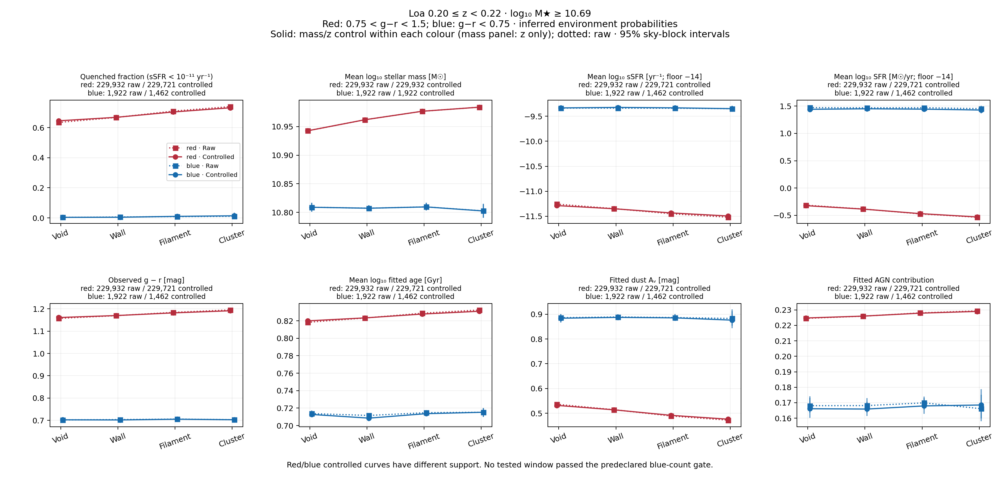
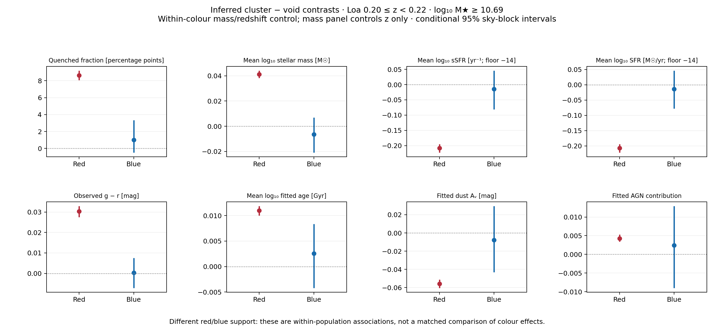
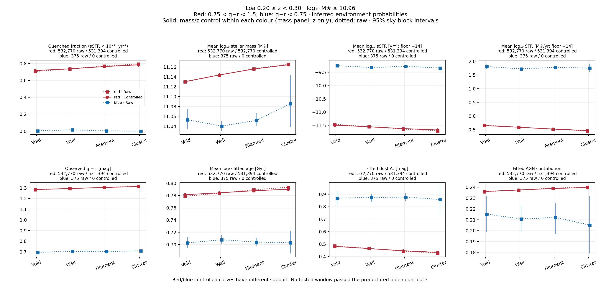

# Loa red/blue properties versus inferred environment — 2026-10-16

Using the requested observed-colour definition, red galaxies show coherent
property trends from inferred voids to clusters after controlling stellar mass
and redshift. The blue sample is much smaller and does not establish a trend.
Reducing the upper redshift limit from .30 to .22 lowers the colour-audited
empirical mass-completeness threshold from 9.12e10 to 4.90e10 solar masses.

## Definitions and selection

Red: **0.75 < g−r < 1.5**. Blue: **g−r < 0.75**. Exact boundaries, nonfinite
colours and values >=1.5 are excluded from both plotted groups. Colour is
computed from Milky-Way-corrected observed Legacy Survey g/r fluxes, without
K correction. These are colour-defined populations, not interchangeable with
sSFR-defined quenched/star-forming populations. No atomic-gas or star-forming
sequence was assumed or fitted.

The parent is the previously validated Bright/CG15/P12-A matched sample.
Completeness is re-audited separately for red and blue galaxies using the
faintest 20% and the 95th percentile of flux-rescaled limiting masses in .01-wide
redshift bins. Adopt the maximum of the prior all/quiescent/starforming limit
and the new red/blue limits, then the maximum over each redshift window rounded
up to .01 dex. Positive g/r flux and transmission are required for parent colours.
This is empirical flux completeness, not absolute survey completeness.

| Redshift range | log10 mass threshold | Mass threshold [solar masses] | All selected | Red | Blue |
|---|---:|---:|---:|---:|---:|
| .20–.30 | 10.96 | 9.12e10 | 611,197 | 532,770 | 375 |
| .20–.25 | 10.77 | 5.89e10 | 510,838 | 506,893 | 1,805 |
| .20–.23 | 10.73 | 5.37e10 | 329,370 | 327,096 | 1,904 |
| .20–.22 | 10.69 | 4.90e10 | 232,024 | 229,932 | 1,922 |

All selected includes objects outside the colour definitions. Intervals include
the lower boundary and exclude the upper. The lower bound stays at .20.
The narrower window reduces the mass threshold by .27 dex (a factor 1.86).
It does not reach dwarf-galaxy masses.

Before examining property outcomes, the selection rule required >=20,000 per
colour and >=100 per hard environment class per colour. **No window passed.**
The .20–.22 sample is therefore an exploratory lower-mass demonstration, not a
successful primary-sample selection. Its blue hard-class counts are
477/863/517/65 (void/wall/filament/cluster); the .20–.30 counts are 83/165/113/14.

## Plots and measured trends

Solid curves below standardize mass (.1 dex) and redshift (.01) within each
colour using soft P_WEB weights and Kish count >=20 in every environment per
retained stratum. The mass panel controls only redshift. Dotted curves are raw
soft-weighted means. Red and blue have different retained support; their vertical
separation is not a common-mass comparison of colour effects. Property-specific
validity avoids a joint SFR/age/dust availability selection.

For red galaxies at .20–.22, controlled quenched fractions are
64.55%, 66.84%, 70.41%, 73.19% across inferred void/wall/filament/cluster.
The cluster-minus-void contrast is **8.64 percentage points**, with conditional
95% interval **[8.06, 9.21]**. Mean log sSFR falls **.208 dex**, g−r increases
**.0304 mag**, and fitted age increases slightly. Fitted dust attenuation falls;
the fitted AGN contribution increases slightly. These SED parameters are not
independent detections of age, dust physics or AGN incidence.

The blue controlled log-sSFR contrast is **−.015 dex [−.082, +.046]**;
its quenched-fraction contrast is **+1.02 percentage points [−.49, +3.34]**.
The intervals for all eight reported blue contrasts include zero. This is
no detected trend with the present sample and controls, not proof of no
physical environmental dependence.

| Property | Red cluster − void (95% interval) | Blue cluster − void (95% interval) |
|---|---:|---:|
| Quenched fraction [percentage points] | +8.6434 [+8.0608, +9.2104] | +1.0190 [-0.4926, +3.3413] |
| Mean log stellar mass [dex; z control only] | +0.0412 [+0.0382, +0.0442] | -0.0065 [-0.0209, +0.0069] |
| Mean log sSFR [dex] | -0.2083 [-0.2228, -0.1950] | -0.0150 [-0.0815, +0.0462] |
| Mean log SFR [dex] | -0.2073 [-0.2220, -0.1943] | -0.0138 [-0.0774, +0.0469] |
| Observed g−r [mag] | +0.0304 [+0.0275, +0.0330] | +0.0003 [-0.0072, +0.0075] |
| Mean log fitted age [dex] | +0.0110 [+0.0100, +0.0119] | +0.0025 [-0.0042, +0.0084] |
| Fitted A_V [mag] | -0.0559 [-0.0606, -0.0511] | -0.0078 [-0.0432, +0.0296] |
| Fitted AGN contribution | +0.0043 [+0.0034, +0.0053] | +0.0024 [-0.0090, +0.0129] |

## Original range and support sensitivity

At .20–.30, red controlled quenched fractions rise 71.70%→78.51%, a
6.81-point contrast [6.44, 7.20]. The 375 blue galaxies have no supported
controlled comparison, so only their raw curves are shown.

At .20–.22, .1 dex soft-only controls retain 229,721 red and 1,462 blue
objects for the non-mass properties; z-only mass controls retain 229,932/1,922.
Using .05 dex bins retains 229,436 red and 996 blue galaxies. The red quenched
contrast remains 8.63 points and log-sSFR contrast −.208 dex. The blue quenched
contrast changes sign to −.39 points [−1.24, +.17], reinforcing the absence of
a stable blue detection. Its log-sSFR contrast remains consistent with zero.

Requiring joint soft/hard support within each colour leaves 229,298 red but
only 447 blue objects in one .1 dex stratum; .05 dex leaves no supported blue
stratum. This narrower reference is not interchangeable with the main soft-only
reference. All raw, soft-only and joint results are preserved in JSON/CSV.
The failed initial shared-colour analysis is preserved separately in v1.

Intervals use 256 paired HEALPix nside=8 sky resamples on fixed cells/reference
weights. All reported successful bootstrap curves have 256 valid draws.
They exclude SED errors, uncertainty in the completeness boundary, fibre/other
survey selection effects, and environment-model transfer or calibration error.
For sparse binary outcomes, a zero-event nonparametric interval can collapse:
that is not evidence of a population quenched probability exactly zero.
Mean log SFR/sSFR uses a labelled −14 floor; quenching uses unfloored sSFR.
These are associations with inferred environment, not causal or calibration
claims. No multiple-testing claim is made across the property panels.

## Products, provenance and checks

- [Final PNG/PDF figures](figures/loa_colour_split_20261016/).
- [All curves and contrasts CSV](evidence/loa_colour_split_20261016/curves_and_contrasts.csv).
- [Full numerical results](evidence/loa_colour_split_20261016/relationships.json).
- [Colour limits and counts](evidence/loa_colour_split_20261016/).
- [Method and execution source](../workflows/presentation/loa_mass_complete_20261016/COLOUR_SPLIT.md).
- [Original-range sub-VAC](/pscratch/sd/d/dkololgi/graphweb_desi/outputs/loa_colour_split_20261016_v1/LOA_COLOUR_MASS_COMPLETE_z020030.fits).
- [Lower-mass sub-VAC](/pscratch/sd/d/dkololgi/graphweb_desi/outputs/loa_colour_split_20261016_v2/LOA_COLOUR_MASS_COMPLETE_z020022.fits).

The sub-VACs preserve the cached source columns and append COLOUR_CLASS:
−1 excluded, 0 blue, 1 red. The narrower output also adds COLOUR_LOGM_LIMIT.
Use MCFIX/MCZLO/MCZHI in each FITS header for its new selection; legacy
SELECT_FIXED020030 and LOGM_LIMIT95 retain their original meanings.

Passed checks: exact colour boundaries/exclusions; upward mass-limit rounding;
independent sorted-percentile reconstruction; direct reconstruction of every
reported raw/controlled mean; all original columns checked in 257 FITS
roundtrip rows per output; final figure/CSV copies hash-verified. Final figures
visually inspected. These extend, rather than replace, the previous catalogue
source-parity audit. Source, audit, analysis and presentation manifests form an
explicit SHA256 chain. Code and small evidence live in GraphWeb_DESI; large
FITS/caches stay on Scratch. No training or new environment inference.

Compute used approved CPU allocation 59855238 on nid200002, account desi,
interactive QOS, within the approved 45-minute limit. Graphify remained
unavailable (`command not found`); direct scoped inspection was used.

Allocation 59855238 was released after 10m19s. Scheduler accounting confirms
allocation and all three payload steps COMPLETED, exit 0:0. In total, 194 raw
or standardized four-class mean vectors were independently reconstructed;
every successful bootstrap retained all 256 draws. Report links resolve.
