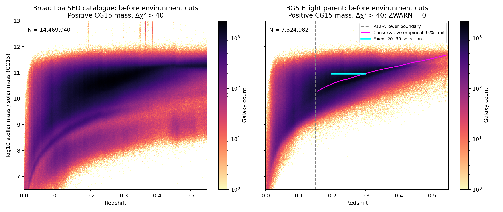
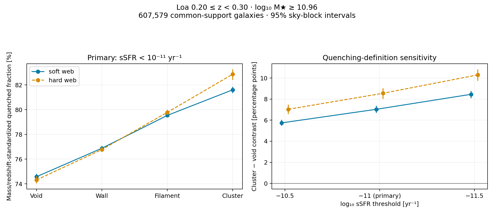
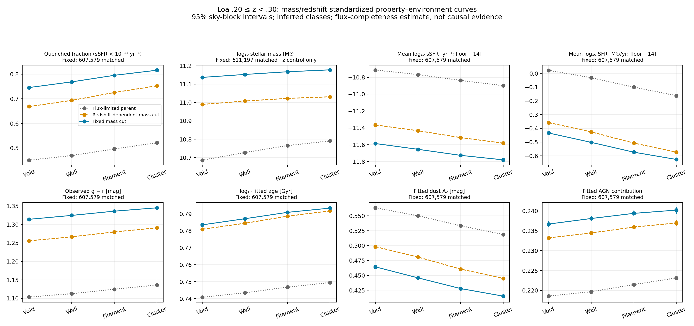
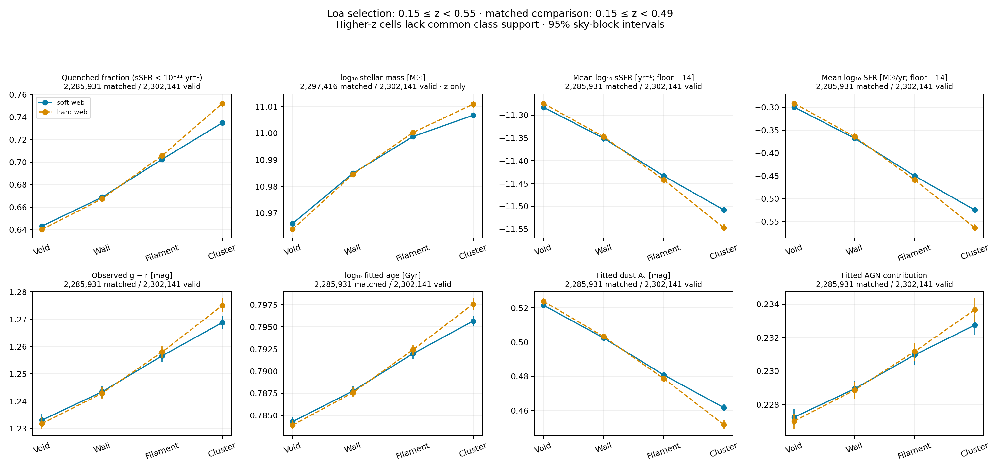

# Loa low-mass parent audit and empirical mass-complete environment analysis

2026-10-16. The missing low-mass tail in the earlier plot was a selection/display
problem: it combined the already mass-selected old GAT VAC with P12-A, whose
inference support starts at z=0.15. It was not the Loa parent distribution.
The newly constructed mass-selected samples retain a positive quenched-fraction
association with inferred environment after stellar-mass/redshift matching.

## Parent audit

The broad CG15 SED parent contains 14,469,940 unique eligible IDs at 0<z<0.55
after requiring GALAXY, DELTACHI2>40 and positive finite mass. Duplicate eligible
IDs are excluded (1,527,262 rows), not arbitrarily resolved. This is a broader
targeting population than the historical example labelled 5,130,670 galaxies;
the exact provenance and mass convention of that image were not recovered.
It must not be called an exact reproduction of that historical sample.

The separately matched BGS Bright parent additionally requires ZWARN=0,
DELTACHI2>40 and extinction-corrected r<19.5 South /19.54 North. It contains
7,324,982 galaxies before the environment-inference cut. At z<0.15 it includes:

- **266,849 galaxies below 10^9 solar masses**;
- **30,845 galaxies between 10^7 and 10^8 solar masses**.

Thus the low-mass tail exists even within BGS Bright. The broad all-targeting
SED parent has 1,090,694 and 299,151 objects in those two respective selections.
These are catalogue mass estimates, not independently validated true masses.
The SED-only parent lacks a ZWARN column; the Bright parent has the explicit
ZWARN quality cut. The attached historical image also shows Faint and low-z
secondary selection curves, which are not interchangeable with Bright.

The old GAT VAC used raw FastSpecFit LOGMSTAR>=9 and 0.01<=z<0.06; its physical
mass convention included an h=0.704 conversion. Its saved CG15 matches were
already selected. P12-A's z=0.15 lower boundary is a mock-truth-mapping validity
restriction, not a DESI detection boundary. The dashboard also limited its
property input to CG15 log mass 9-12. None of those restrictions belongs in a
plot advertised as the unrestricted observed parent.

## Mass-completeness recipe and products

In each dz=0.01 bin, estimate the limiting mass by
`logM_lim = logM + 0.4*(r-r_limit)`. For the faintest 20% of each population,
take the 95th percentile separately for all galaxies, quiescent galaxies and
star-forming galaxies; use the largest of the three. Each population requires
at least 100 rows. All 40 bins from 0.15 to 0.55 pass that support requirement.
Quiescent here means SFR/M<1e-11 per year. This follows the empirical
[limiting-mass approach](https://www.aanda.org/articles/aa/pdf/2010/16/aa12801-09.pdf),
with an explicit conservative population envelope.

| Redshift bin | Adopted log10 mass limit | Previous-style all-population 90th percentile |
|---|---:|---:|
| 0.15-0.16 | 10.284 | 10.174 |
| 0.20-0.21 | 10.602 | 10.508 |
| 0.25-0.26 | 10.793 | 10.721 |
| 0.29-0.30 | 10.951 | 10.888 |
| 0.40-0.41 | 11.274 | 11.232 |
| 0.54-0.55 | 11.684 | 11.649 |

A fixed 3e10 solar-mass threshold is too low for the entire 0.20-0.30 interval.
The primary sample uses the largest estimated limit in that interval, rounded
up to 0.01 dex: **log10(M/solar mass)>=10.96**, or **9.12e10 solar masses**.

| Product | Selection | Rows |
|---|---|---:|
| `LOA_P12A_MASS_COMPLETE_fixed020030.fits` | 0.20<=z<0.30, logM>=10.96 | **611,197** |
| `LOA_P12A_MASS_COMPLETE_zdependent.fits` | 0.15<=z<0.55, bin-dependent empirical limit | **2,302,141** |

Both files are in
`/pscratch/sd/d/dkololgi/graphweb_desi/outputs/loa_mass_complete_20261016_v1/`.
They preserve every original VAC column, including P_WEB, eigenvalue summaries
and quality information. Added fields record original source row, dereddened r,
flux limit, observed g-r, adopted mass limit, selection flags, SFR validity and
quenching flag. The original release is unchanged. Supported, unambiguous CG15
matches and unique IDs are required; SFR/age/dust/AGN validity is not a condition
for inclusion in the sub-VAC. All 611,197 primary-sample SFR values happen to
pass the nonnegative finite validity test.

The stricter DELTACHI2>40 quality cut follows the
[DESI BGS redshift-quality convention](https://lss.fnal.gov/archive/2025/pub/fermilab-pub-25-0845-ppd.pdf).
It is stricter than the original VAC's advertised >=25 selection.

These are **empirical flux-completeness selections**, not proof of absolute
completeness. The 95th percentile refers to the limiting-mass construction;
it neither means retaining 95% of the observed sample nor certifies 95% of all
real galaxies were observed. Surface brightness, fibre assignment, redshift
success, SED-fitting failures, mass errors and a missing high-M/L population
remain relevant. The strongest primary comparison is the narrow fixed-cut
sample, not an uncontrolled stack across all redshifts.

## Quenching and controlled relationships

The primary definition is **sSFR<1e-11 yr^-1** using CG15 SFR and mass, with
-10.5 and -11.5 log-sSFR thresholds as sensitivity checks. This is a standard
operational definition; UVJ and distance below the star-forming main sequence
are alternatives with non-negligible systematic differences
([Donnari et al. 2019](https://academic.oup.com/mnras/article/485/4/4817/5376508)).
The inspected source lacks rest-frame U,V,J magnitudes. A single observed g-r
cut is not substituted for UVJ, because redshift and dust affect it. Observed
g-r remains a separately displayed property. Zero SFR counts as quenched;
invalid SFR has flag -1. The -14 floor applies only to displayed mean logarithms.

For each property, soft probability-weighted and hard argmax web classes use
the same common mass/redshift cells and pooled reference distribution. Cells
require Kish effective N>=20 in every class and both methods. The baseline
uses 0.1 dex mass and dz=0.01 bins; 0.05 dex repeats the check. The mass panel
controls redshift only. All other panels control both mass and redshift.
Property-specific validity masks avoid requiring an age/AGN fit to measure
quenching. Uncertainty is a paired 256-draw HEALPix nside=8 sky-block bootstrap,
with fixed control cells, class assignments and reference weights.

The primary quenching comparison retains **607,579 of 611,197 galaxies**:

| Inferred environment | Probability-weighted quenched fraction | Hard-class fraction |
|---|---:|---:|
| Void | 74.57% | 74.31% |
| Wall | 76.88% | 76.77% |
| Filament | 79.53% | 79.78% |
| Cluster | 81.60% | 82.87% |

The probability-weighted cluster-minus-void contrast is **7.03 percentage
points**, conditional 95% interval **6.69-7.36**. The hard-class contrast is
**8.55 points**, interval **8.01-9.04**. Soft weighting describes an association
with the supplied class probabilities; it is not a deconvolved estimate of
true environment-class fractions or a new calibration result.

The sign persists under the declared checks:

| Primary-sample check | Soft cluster-minus-void quenched contrast |
|---|---:|
| 0.1 dex mass matching, log sSFR<-11 | 7.03 pp [6.69, 7.36] |
| 0.05 dex mass matching | 7.01 pp [6.67, 7.35] |
| Additional 0.1 dex mass cut | 6.23 pp [5.88, 6.61] |
| log sSFR<-10.5 | 5.74 pp [5.48, 6.03] |
| log sSFR<-11.5 | 8.46 pp [8.08, 8.77] |

Other mass/redshift-matched soft-class cluster-minus-void differences are:

| Property | Difference | Conditional 95% interval |
|---|---:|---:|
| Mean log10 sSFR | -0.194 dex | [-0.202, -0.186] |
| Mean log10 SFR | -0.193 dex | [-0.201, -0.185] |
| Observed g-r | +0.0311 mag | [+0.0293, +0.0327] |
| log10 fitted age/Gyr | +0.00985 dex | [+0.00933, +0.01042] |
| Fitted A_V | -0.0491 mag | [-0.0519, -0.0468] |
| Fitted AGN contribution | +0.00351 | [+0.00294, +0.00413] |

AGE is the SED-fit parameter, not an established mass-weighted age; AGN
contribution is not AGN incidence. Those fitted quantities are correlated
SED outputs and should not be treated as independent physical detections.
The separately redshift-matched stellar-mass contrast is +0.0411 dex; that
panel intentionally does not condition on stellar mass itself.

For the redshift-dependent sub-VAC, 2,285,931 of 2,302,141 rows enter the common
quenching support. The soft contrast is 9.18 pp [8.99, 9.39]. **The selected
catalogue reaches z=0.55, but the matched comparison reaches only z<0.49**;
higher-z cells lack shared class support. No relationship is imputed there.
The different mass/redshift mixture means this full-range contrast is not the
same estimand as the primary 0.20-0.30 contrast.

The intervals above quantify conditional spatial sampling, not total scientific
uncertainty. They exclude correlated mass/SFR errors, uncertainty in the
completeness curve, observational selection systematics and model transfer.
The result is an environmental association that survives these selection and
matching checks, not causal quenching evidence or proof of calibrated DESI
environment labels. Comparisons between selection curves use different pooled
reference populations and cannot isolate the causal effect of a mass cut.

## Reproducibility and verification

Code: `workflows/presentation/loa_mass_complete_20261016/`.
Original sources: the frozen full P12-A CG15 VAC, Loa BGS_BRIGHT full HPmapcut
catalogue v2.1, and `dr2_galaxy_sedfitting_v1.0.fits`. Output manifests record
paths, sizes, modification times, source-code hashes and output hashes.

Six small arithmetic tests passed. The independent catalogue validator passed
124 grouped checks, including rescaled-mass quantiles and every original column
at 257 fresh source rows in each sub-VAC. Independent curve reconstruction
passed 12 primary and 12 full-range checks covering both class estimators,
three quenching thresholds and both mass-bin widths. All four figure exports
were visually inspected; sample labels were moved away from plotted points.

Work ran on approved CPU allocation 59853892, node nid200058. One preliminary
scan was stopped to add explicit redshift-quality filtering before producing
outputs. There was no GPU use, training, new environment inference, or change
to other jobs. `graphify` was unavailable, so targeted source inspection was
used. The final machine-readable records include selection summaries, full
relationship JSON/CSV, validation receipts and the output manifest.
