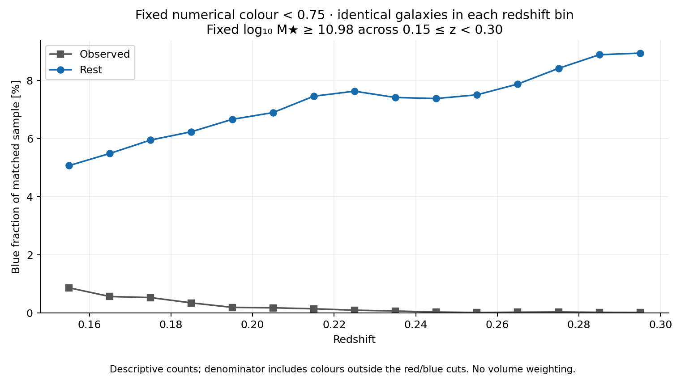
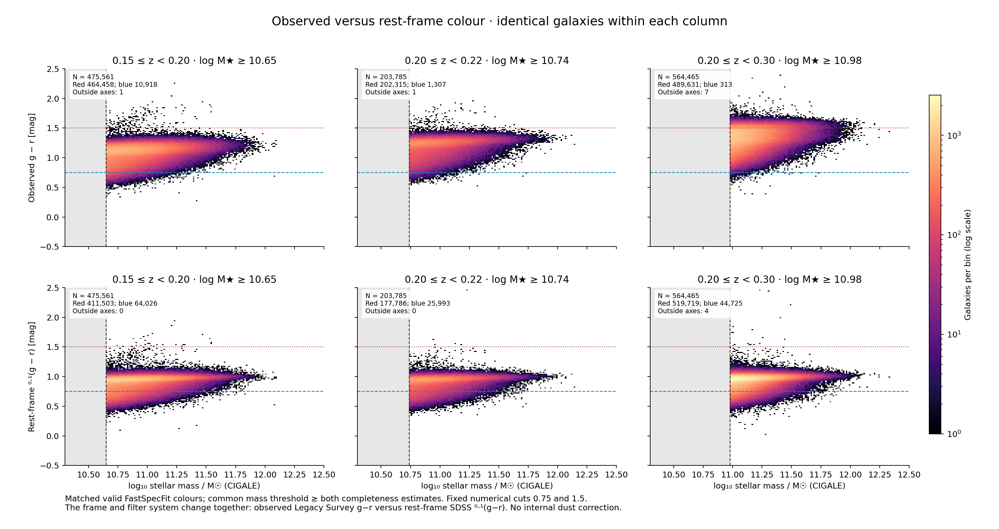

# Rest-frame colour and inferred-environment audit — Loa, 2026-10-16

The fixed observed g−r selection substantially suppresses the objects called blue at higher redshift. Replacing it with rest-frame SDSS 0.1(g−r) restores much larger blue samples on the same galaxies. The revised samples show small negative cluster-minus-void mean log-sSFR contrasts; red-population trends remain stronger. These are conditional associations, not calibration or causal results.

## Same-galaxy evidence for the colour-selection effect

The following comparison holds each original mass threshold and the matched galaxy set fixed. Only the colour definition changes. Blue means colour <0.75 in both frames; red means 0.75<colour<1.5. Exact boundaries and values >=1.5 are outside the plotted colour groups.

| Redshift | Original mass floor | Valid same-galaxy rows | Observed blue | Rest-frame blue | Ratio | Median observed minus rest colour [mag] |
|---|---:|---:|---:|---:|---:|---:|
| 0.15–0.20 | 10.60 | 534,069 | 14,909 | 79,206 | 5.31 | 0.182 |
| 0.20–0.22 | 10.69 | 232,024 | 1,922 | 32,793 | 17.06 | 0.282 |
| 0.20–0.30 | 10.96 | 611,195 | 375 | 51,292 | 136.78 | 0.410 |

In 0.20≤z<0.30, 50,917 galaxies classified red by the observed cut move into the rest-frame blue category at the original mass threshold. All 375 originally blue objects remain blue. Another 78,031 objects formerly above the red upper boundary move into the rest-frame red category. Full transition matrices, including all exclusions, are recorded in `windows.json`. The old blue result therefore describes a particularly restrictive observed-colour subset; it should not be generalized to rest-frame blue galaxies.

At a single fixed mass floor of 10.98 throughout 0.15≤z<0.30, the observed blue fraction drops from 0.865% in 0.15–0.16 to 0.0159% in 0.29–0.30. For the identical galaxies in each bin, the rest-frame fraction is 5.07% and 8.94%, respectively. Thus the observed-colour decline is not explained solely by the rising window-specific mass floor. These descriptive fractions do not establish population evolution: selection, mass distributions above the floor, cosmic variance and fitted-colour systematics still matter.

## Definition, provenance and coverage

The inspected Zou/CIGALE catalogue does not contain rest-frame magnitudes. We use `ABSMAG01_SDSS_G - ABSMAG01_SDSS_R` from the matching Loa FastSpecFit v1.0 catalogue. These are SDSS bands shifted to reference redshift 0.1, not unshifted z=0 bands; their common h convention cancels in the colour. CIGALE stellar masses and other properties remain unchanged. See the [FastSpecFit data model](https://fastspecfit.readthedocs.io/en/3.0.0/fastspec.html) and [Loa product documentation](https://fastspecfit.readthedocs.io/en/latest/loa.html).

This is observed Legacy Survey g−r versus rest-frame SDSS 0.1(g−r), so both frame and filter system change, with model-dependent K corrections. The result is not a pure same-filter K-correction experiment. Rest-frame colours retain internal attenuation. Neither numerical colour cut is asserted to be a universal physical separation of quenched and star-forming populations.

Of 3,734,198 Bright-parent galaxies at 0.15≤z<0.30, all have unique TARGETID matches; 3,734,189 pass the rest-colour quality checks. Nine fail; none is missing or duplicated. All 384 fresh source-row checks pass. The three original environment samples retain 99.9998%, 100% and 99.9997%, respectively. Coverage is also recorded by hard environment, redshift bin and mass bin.

Quality requires exact metadata/SPECPHOT TARGETID alignment, sky agreement within 1 arcsec, both fitted and Redrock normalized redshift agreement within 0.001, ZWARN_RR=0, DELTACHI2>40, finite nonzero magnitudes, positive finite g/r inverse variance and positive finite continuum reduced chi-square. The positive-IVAR condition excludes synthetic-only magnitudes, following the [FastSpecFit algorithm notes](https://fastspecfit.readthedocs.io/en/2.5.2/algorithms.html).

## Revised completeness selections

The original faintest-20% / 95th-percentile flux-completeness recipe is repeated in each dz=0.01 bin for rest-frame red/blue groups. It retains the original all/quenched/star-forming floor. The final threshold is the maximum over the window and all predeclared 0.70/0.75/0.80 boundary variants, rounded upward to 0.01 dex. These conservative floors exceed every input variable-cut limit, so the cached source does not truncate qualifying objects. This remains empirical flux completeness, conditional on the catalogue and available colours.

| Redshift | Revised mass floor | Total valid rows | Rest red | Rest blue | Blue hard-cluster count | Count gate |
|---|---:|---:|---:|---:|---:|---|
| 0.15–0.20 | 10.65 | 475,561 | 411,503 | 64,026 | 2,566 | Pass |
| 0.20–0.22 | 10.74 | 203,785 | 177,786 | 25,993 | 994 | Pass |
| 0.20–0.30 | 10.98 | 564,465 | 519,719 | 44,725 | 1,630 | Pass |

All three primary 0.75-cut samples pass the earlier pragmatic rule: >=20,000 per colour and >=100 in every hard environment class within each colour. This is a count gate, not a power guarantee, common red/blue support test or model-validation gate. Actual controlled support is reported separately.

Original observed-environment diagrams retain the original mass selections. The paired observed/rest plots use identical valid rows above max(original,revised) mass floor, which equals the revised floor in all three windows. Large derived FITS preserve every original column and append FastSpecFit provenance and rest-colour fields.

## Environment trends

Environment probabilities are frozen P12-A outputs. Highest-probability class views are supplied alongside probability-weighted diagrams. Curves use within-colour standardization over common mass/redshift cells across the environments, with 0.1 dex / 0.01 redshift primary cells; the mass panel controls redshift only. Finer 0.05 dex and joint soft/hard-support specifications are retained. Red and blue supports and reference distributions differ. Intervals use 256 paired HEALPix sky-block bootstrap draws and condition on fixed selection, colour definitions and predictions.

| Redshift | Blue Δ log sSFR [dex; 95% CI] | Blue Δ quenched [pp; 95% CI] | Red Δ log sSFR [dex; 95% CI] | Red Δ quenched [pp; 95% CI] |
|---|---:|---:|---:|---:|
| 0.15–0.20 | -0.047 [-0.061, -0.033] | +0.846 [+0.366, +1.337] | -0.157 [-0.168, -0.145] | +7.249 [+6.722, +7.683] |
| 0.20–0.22 | -0.042 [-0.071, -0.011] | +0.920 [-0.196, +2.122] | -0.161 [-0.174, -0.145] | +6.542 [+5.933, +7.147] |
| 0.20–0.30 | -0.046 [-0.070, -0.025] | +0.679 [-0.339, +1.660] | -0.147 [-0.155, -0.139] | +5.086 [+4.818, +5.412] |

At the primary 0.75 boundary, negative blue log-sSFR and positive blue rest-colour contrasts survive all four tested matching specifications in all three windows. Blue colour contrasts are only 0.0034, 0.0053 and 0.0032 mag. At 0.70 in the widest window, the strictest joint/fine support retains just 7,276 blue galaxies: log-sSFR is −0.030 dex with interval [−0.072,+0.012], and the colour interval also includes zero. Hence the signal is more stable than in the observed-colour subset, but not significant in every sensitivity specification. All 12 boundary/support combinations are shown in the final sensitivity figures.

Blue quenched-fraction contrasts are small and boundary-sensitive. The primary higher-redshift intervals include zero. The raw rest-blue quenched fractions are 4.84%, 6.19% and 12.33% in increasing window order, so this remains a colour-selected mixture rather than an isolated star-forming sequence. Red quenched fractions rise from 73.0% to 80.3%, 75.5% to 82.0%, and 82.0% to 87.1% under the primary controls.

Other property estimates are included below and in the figures/CSV. Fitted age, attenuation, AGN contribution and SFR are correlated SED-derived quantities; their apparent trends are not independent physical confirmations. SFR and sSFR are algebraically related at fixed mass. The confidence intervals omit colour and SED uncertainties, completeness-boundary uncertainty, selection systematics and simulation-to-data transfer. Multiple exploratory properties/specifications are displayed without multiplicity-adjusted discovery claims. The overlapping high-z windows are not independent replications.

### All primary contrasts: 0.15–0.20

| Property | Red Δ [95% CI] | Blue Δ [95% CI] |
|---|---:|---:|
| quenched [pp] | +7.24859 [+6.72193, +7.68258] | +0.84612 [+0.36598, +1.33700] |
| logmass | +0.03816 [+0.03603, +0.04037] | +0.00952 [+0.00603, +0.01303] |
| logssfr | -0.15738 [-0.16819, -0.14546] | -0.04696 [-0.06111, -0.03286] |
| logsfr | -0.15719 [-0.16801, -0.14514] | -0.04645 [-0.06089, -0.03212] |
| colour | +0.01309 [+0.01188, +0.01424] | +0.00343 [+0.00182, +0.00501] |
| logage | +0.00917 [+0.00829, +0.01005] | +0.00223 [+0.00120, +0.00321] |
| av | -0.04934 [-0.05364, -0.04480] | -0.02458 [-0.03183, -0.01681] |
| fagn | +0.00246 [+0.00159, +0.00330] | +0.00268 [+0.00097, +0.00411] |

### All primary contrasts: 0.20–0.22

| Property | Red Δ [95% CI] | Blue Δ [95% CI] |
|---|---:|---:|
| quenched [pp] | +6.54241 [+5.93288, +7.14687] | +0.92004 [-0.19639, +2.12207] |
| logmass | +0.04010 [+0.03685, +0.04306] | +0.01312 [+0.00809, +0.01877] |
| logssfr | -0.16075 [-0.17393, -0.14499] | -0.04150 [-0.07099, -0.01080] |
| logsfr | -0.15970 [-0.17283, -0.14392] | -0.04093 [-0.07090, -0.00998] |
| colour | +0.01266 [+0.01117, +0.01454] | +0.00533 [+0.00319, +0.00747] |
| logage | +0.00909 [+0.00792, +0.01000] | +0.00221 [+0.00062, +0.00403] |
| av | -0.04837 [-0.05388, -0.04304] | -0.01817 [-0.03246, -0.00215] |
| fagn | +0.00314 [+0.00212, +0.00449] | +0.00229 [-0.00046, +0.00484] |

### All primary contrasts: 0.20–0.30

| Property | Red Δ [95% CI] | Blue Δ [95% CI] |
|---|---:|---:|
| quenched [pp] | +5.08571 [+4.81780, +5.41160] | +0.67949 [-0.33902, +1.65996] |
| logmass | +0.04132 [+0.03998, +0.04261] | +0.00860 [+0.00544, +0.01192] |
| logssfr | -0.14682 [-0.15497, -0.13942] | -0.04619 [-0.06968, -0.02456] |
| logsfr | -0.14576 [-0.15397, -0.13835] | -0.04591 [-0.06948, -0.02437] |
| colour | +0.01377 [+0.01291, +0.01463] | +0.00321 [+0.00167, +0.00510] |
| logage | +0.00801 [+0.00731, +0.00859] | +0.00122 [-0.00015, +0.00263] |
| av | -0.04061 [-0.04367, -0.03805] | -0.02171 [-0.03264, -0.01200] |
| fagn | +0.00341 [+0.00279, +0.00403] | +0.00122 [-0.00079, +0.00333] |

## Figure and evidence index

- [Observed colour by hard environment](figures/loa_rest_colour_20261016/colour_mass_observed_hard.png) · [probability-weighted](figures/loa_rest_colour_20261016/colour_mass_observed_soft.png).
- [Rest colour by hard environment](figures/loa_rest_colour_20261016/colour_mass_rest_hard.png) · [probability-weighted](figures/loa_rest_colour_20261016/colour_mass_rest_soft.png).
- 0.15–0.20: [rest-frame property trends](figures/loa_rest_colour_20261016/properties_rest_primary_z015020.png), [all sensitivity contrasts](figures/loa_rest_colour_20261016/contrasts_rest_sensitivity_z015020.png), [paired observed trends](figures/loa_rest_colour_20261016/properties_paired_observed_z015020.png).
- 0.20–0.22: [rest-frame property trends](figures/loa_rest_colour_20261016/properties_rest_primary_z020022.png), [all sensitivity contrasts](figures/loa_rest_colour_20261016/contrasts_rest_sensitivity_z020022.png), [paired observed trends](figures/loa_rest_colour_20261016/properties_paired_observed_z020022.png).
- 0.20–0.30: [rest-frame property trends](figures/loa_rest_colour_20261016/properties_rest_primary_z020030.png), [all sensitivity contrasts](figures/loa_rest_colour_20261016/contrasts_rest_sensitivity_z020030.png), [paired observed trends](figures/loa_rest_colour_20261016/properties_paired_observed_z020030.png).
- Every PNG has a matching PDF in the same directory.
- [All numerical curves and contrasts](evidence/loa_rest_colour_20261016/curves_and_contrasts.csv).
- [Archive index with hashes](evidence/loa_rest_colour_20261016/ARCHIVE_INDEX.json).
- [Independent validation](evidence/loa_rest_colour_20261016/validation.json).

## Execution and validation

Approved CPU allocation 59858561 ran on nid200021 and was released; squeue subsequently returned no job, no stderr and exit zero. Preparation, analysis, rendering and independent validation exited zero. Final rendering v2 expands the sensitivity grid and reduces tick crowding; v1 and its manifest remain on Scratch. The main comparison, observed hard-environment, rest soft-environment, primary low-z trends, fixed-mass fractions and revised widest-window sensitivity PNGs were visually inspected.

Checks passed for all 90 rest-colour limiting percentiles, 384 fresh FastSpecFit source rows, 257-row roundtrips for each of six derived primary/paired FITS files, and fresh original-VAC agreement across all 50 original columns at 257 rows per file. The original observed TARGETID sets agree exactly in all three windows. All 1,364 reported curve vectors passed numerical checks; 46 unsupported controls remain explicitly unavailable. Every available raw/controlled calculation had 256 valid bootstrap draws. Histogram counts were independently reconstructed. Input/output manifests and all archived copies passed SHA256 checks.

Source workflow: `workflows/presentation/loa_rest_colour_20261016/`. Large FITS and the full parent join remain at `/pscratch/sd/d/dkololgi/graphweb_desi/outputs/loa_rest_colour_20261016_v1/`; final figures are in `presentation_v2/`. No inference models were refitted or calibrated by this exercise.

## User display preference after completion

The user subsequently requested only the original observed-colour diagrams split
by inferred environment, to inspect colour–mass bimodality. The requested figure
is `colour_mass_observed_hard.png`, with the probability-weighted alternative
`colour_mass_observed_soft.png`. Both retain the original CIGALE masses, observed
g−r and original mass thresholds (10.60, 10.69, 10.96). FastSpecFit stellar masses
were never used in any analysis here; only its rest-frame magnitudes entered the
separately archived comparison. The rest-frame results are retained as exploratory
provenance, not substituted for the user's selected plots.
