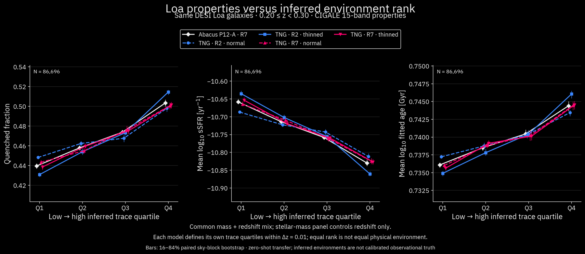
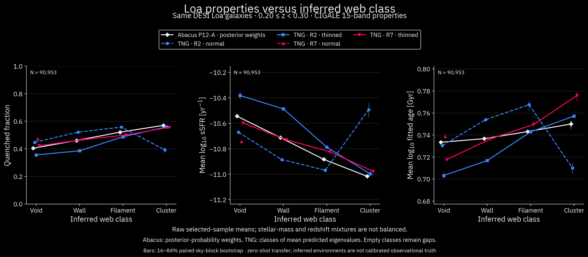

# Same-galaxy Loa property–environment overlays: Abacus and TNG

Completed 2026-10-15. The requested five model families are plotted on the
same observed galaxies: current Abacus P12-A R7 and the controlled TNG R2/R7
regressors trained at normal/thinned density. These TNG models are the new
geometry-only regressors from the controlled experiment, not the old GAT.
The historical TNG GNN has not been retrained at these four settings or applied
in this overlay; this distinction was explicitly clarified with the user.

## Plots

- [Combined eight-page PDF](figures/loa_tng_abacus_overlay_20261015/LOA_TNG_Abacus_comparison.pdf)
- [Seven properties, controlled environment-rank overlay](figures/loa_tng_abacus_overlay_20261015/rank_controlled.png)
- [Seven properties, usual Abacus posterior-weighted classes versus TNG classes](figures/loa_tng_abacus_overlay_20261015/class_soft_abacus.png)
- [Seven properties, classes of mean eigenvalues for every model](figures/loa_tng_abacus_overlay_20261015/class_raw.png)
- [Seven properties, raw environment-rank overlay](figures/loa_tng_abacus_overlay_20261015/rank_raw.png)
- [Class occupancy](figures/loa_tng_abacus_overlay_20261015/class_occupancy.png)
- [All plotted values as CSV](figures/loa_tng_abacus_overlay_20261015/curves.csv)

The seven properties are stellar mass, SFR, sSFR, quenched fraction, fitted
age, dust attenuation and fitted AGN fraction, all using the same 15-band
CIGALE measurements. Quenched means log10(sSFR/yr^-1)<-11. Positive finite
SFR is required; nonpositive catalogue values are not automatically assigned
to the quenched population. Fitted age is not a verified mass-weighted age.

## What the overlays show

The selected sample contains **90,953 galaxies** in the existing Loa wedge,
RA 120–160 degrees, Dec 14.5–30.6 degrees, 0.20<=z<0.30. All model families
see the same observed tracer population. “Normal” and “thinned” describe the
**TNG training population**, not a new thinning of Loa.

**No mass-completeness cut, completeness weight or volume correction is
applied here.** The 9<=logMstar<12 analysis range and property-quality cuts
are not a completeness treatment. Common mass/redshift weighting controls
mixtures only among observed galaxies; it does not restore missing galaxies.
For the old z=.01–.06 sample, surviving completeness notebooks support using
a completeness calculation to choose a fixed mass threshold and redshift
ceiling, rather than a separate corrective weight. The exact original
selection receipt remains unresolved; see
[the historical selection audit](legacy_gat_comparison_20261014.md).

The controlled rank comparison retains **86,696 identical galaxies** in 139
common mass/redshift cells for each non-mass panel. Stellar mass itself is
controlled only for redshift and retains 90,953. Quenched Q4-minus-Q1 contrast:

| Model | Contrast [percentage points] | 16–84% paired spatial interval |
|---|---:|---:|
| Abacus P12-A R7 | 6.38 | [6.14, 6.63] |
| TNG R2 normal | 4.98 | [4.45, 5.30] |
| TNG R2 thinned | 8.36 | [8.07, 8.66] |
| TNG R7 normal | 5.71 | [5.44, 6.00] |
| TNG R7 thinned | 6.28 | [5.95, 6.58] |

The thinned TNG R7 curves closely track the Abacus rank curves. Thinned TNG
R2 gives a steeper trend, but a steeper observed relationship is not evidence
that its environment predictions are more accurate. These are descriptive
same-population comparisons without observed environment truth.

The class plot exposes a failure that the rank plot cannot: **TNG R7 normal
assigns every selected galaxy to void**. Its other class means are undefined
and shown as gaps, not zeros. Normal-density TNG R2 also transfers poorly:
its small predicted-cluster group reverses the otherwise increasing quenched
trend. At the ensemble level, class fractions from mean eigenvalues are:

| Model | Void | Wall | Filament | Cluster |
|---|---:|---:|---:|---:|
| Abacus P12-A R7 | 20.00% | 43.48% | 31.23% | 5.29% |
| TNG R2 normal | 67.13% | 26.81% | 5.45% | .61% |
| TNG R2 thinned | 1.84% | 17.89% | 71.98% | 8.29% |
| TNG R7 normal | 100% | 0% | 0% | 0% |
| TNG R7 thinned | 23.67% | 37.47% | 32.90% | 5.96% |

Do not equate class-fraction similarity with calibration. The primary class
comparison uses classes of mean eigenvalues for all models; a separate
requested-style overlay uses saved Abacus posterior class probabilities and
TNG point-prediction classes. These are explicitly different membership
estimators. In the latter, raw cluster-minus-void quenched contrasts are
16.59 pp for Abacus, -5.48 for TNG R2 normal, 20.25 for R2 thinned and 13.40
for R7 thinned; R7 normal has no defined contrast. Their differing mass and
redshift mixtures are not removed in these raw class curves.

A common mass/redshift-controlled four-class comparison across all five
models is unavailable because one model has no non-void groups. No sample
support or missing class was invented. The rank comparison provides the
shared-control view while preserving this explicit class failure.

## Inference and measurement contract

- Reuse the verified current Loa property cache, with 103,788 supported query
  rows before geometry/property cuts. Read the full current VAC coordinate
  columns, then retain 587,896 surrounding tracers in a Cartesian bounding
  box padded by 64 Mpc/h. Neighbours outside the displayed wedge are included.
- Construct the exact 11 TNG input features: self-excluded counts at
  1,2,4,7,10,14 Mpc/h and distances to neighbours 1,5,10,20,40, with the same
  log transforms. Self exclusion uses TARGETID, including distance ties.
  Use observed Planck18 redshift-space distances (h=.6766), with no periodic
  wrapping, no density renormalization and no galaxy properties as inputs.
- Require the conservative angular-mask and radial margin to exceed
  max(14 Mpc/h, distance to the 40th neighbour). The latter reaches 25.98
  Mpc/h; the 64-Mpc/h context includes it. This leaves 92,026 geometric
  queries, then 90,953 common valid-property rows with 9<=logMstar<12.
  Mask geometry is addressed; variable angular completeness and RSD remain.
- Load all 12 frozen TNG checkpoints and their own feature/target scalers,
  validate hashes against the training manifest, predict ordered increments
  and invert to physical eigenvalues. Average the three fits' physical
  eigenvalues within each R/density family. Classify that mean at threshold
  .2. This seed ensemble is not a posterior; classifying the average is not
  equivalent to averaging individual class assignments.
- Abacus uses saved current P12-A posterior-mean eigenvalues and, in the
  explicitly probability-weighted supplement, saved P_WEB. No Abacus fit or
  posterior generation is rerun. There is no Abacus R2 model in this plot.
- Rank groups are each model's own trace quartiles within .01-redshift bins,
  with fractional membership for tied boundaries. Equal rank is not equal
  physical environment or the same galaxy subset across different models.
- Controlled means use common .1-dex mass/.01-z cells, minimum Kish count
  20 in every model/group, and identical pooled reference weights. Intervals
  use 256 paired resamples of 21 occupied nside8 sky blocks, at fixed groups
  and reference mixture. They exclude property errors, model-transfer,
  posterior and fit-seed uncertainty.

Individual-fit controlled quenched contrasts span 1.94–5.25 pp for TNG R2
normal, 8.27–8.58 for R2 thinned, 5.68–6.21 for R7 normal and 6.16–6.34 for
R7 thinned. The normal R2 ensemble curve hides substantial seed sensitivity.
On all geometric queries, 9.27% have an input exceeding five marginal training
standard deviations for the dense models, compared with .035% for the sparse
models. This simple feature-range check is not a joint distribution test.

## Verification, files and limits

**489 checks pass.** New first-four-aperture counts exactly match the prior
cache for every query. Twelve independent brute-force queries check all six
counts and five neighbour distances. Twenty-four source-row checks verify
current P12-A predictions, IDs/redshifts and all five CIGALE property fields.
Independent NumPy checkpoint replay differs by at most 1.18e-6; direct raw
and controlled mean reconstruction differs by less than 1.6e-14. Tied-rank
and constant-property controls pass. Primary summary, seven-property and
occupancy renders were visually inspected.

Source code: `workflows/presentation/loa_tng_abacus_overlay_20261015.py`, stages
`prepare`, `analyse`, `verify`, `render`. Run in cosmic_env with one BLAS/
OpenMP thread. Slurm remained unconfigured even outside the sandbox; the
previously authorized bounded single-thread fallback was used. Graphify was
unavailable, so targeted direct source inspection was used.

Output root:
`/global/u2/d/dkololgi/fmsu_tokyo_20261010/loa_tng_abacus_overlay_20261015`.
It contains row-level predictions, input features, exact support indices,
checkpoint/source hashes, curves, statistics, validation and all exports.
The linked repository figure directory contains the compact review bundle.
The inference receipt records the script at inference time; the final source
also contains subsequent plotting and independent validation additions.

The subsequent actual-GAT experiment is now complete, separately documented
in `loa_actual_gat_overlay_20261015.md`. The regressors in this report remain
MLPs; the later GAT results do not retrospectively change their identity.
The separate completeness/redshift sensitivity of these MLPs is recorded in
`loa_selection_sensitivity_20261015.md`.

These are zero-shot TNG-to-Loa plots using the same observed galaxies as
Abacus, not the disjoint old low-z GAT catalogue. Training epoch, cosmology,
galaxy population, observational selection, model architecture and posterior
versus point inference remain different. No release catalogue or model was
changed, and observed property-gradient strength was not used to tune models.
